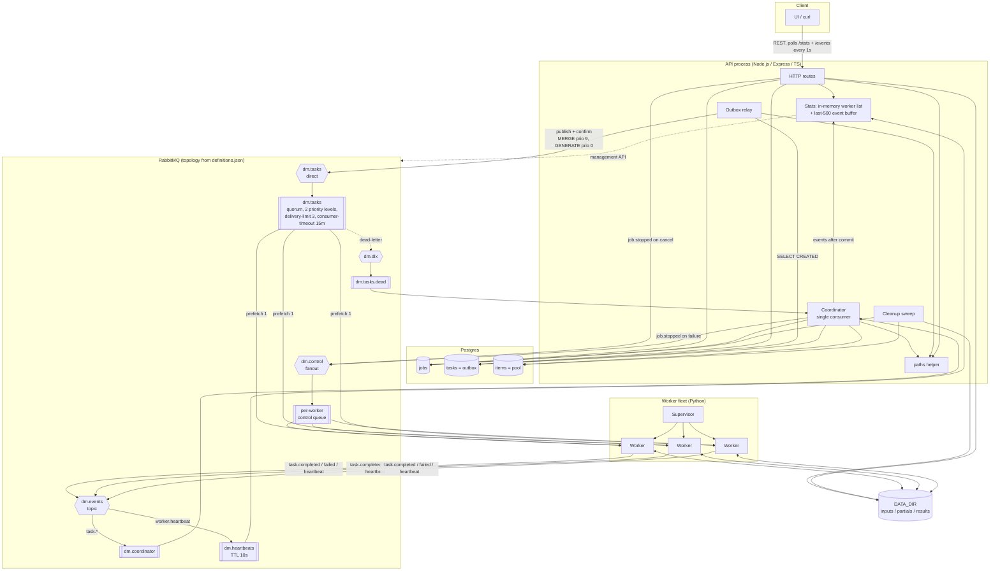

# Component and topology diagram

Rules shown here:
- Workers never connect to Postgres.
- Only the relay publishes tasks.
- Every file path comes from the API's `paths` helper.
- Worker state and events live only in API memory.
