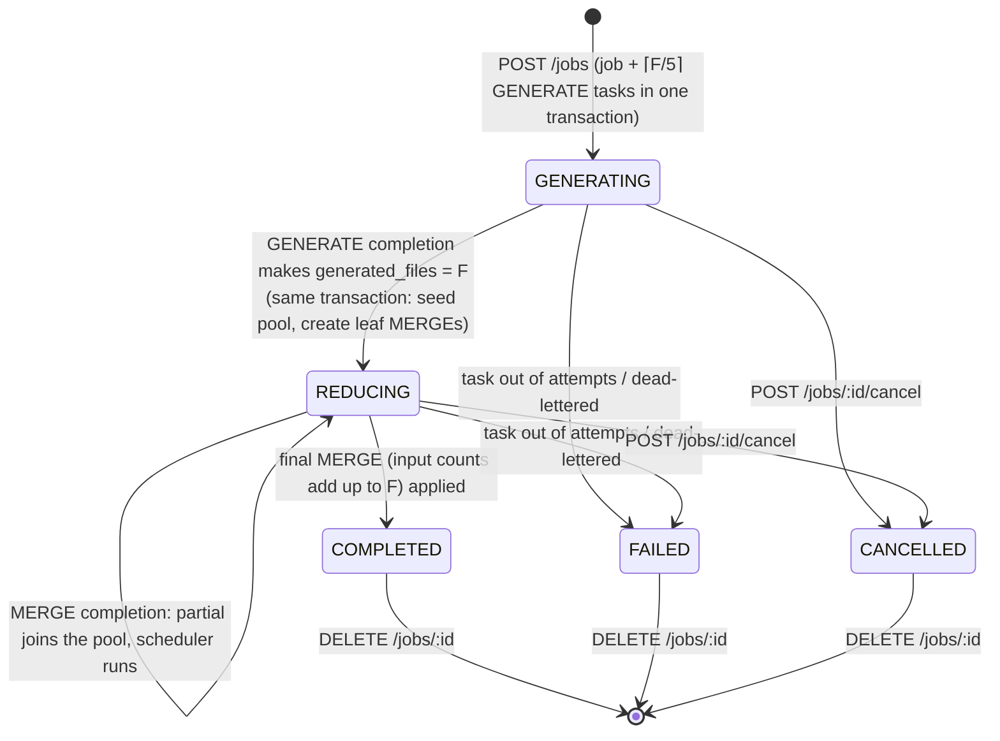
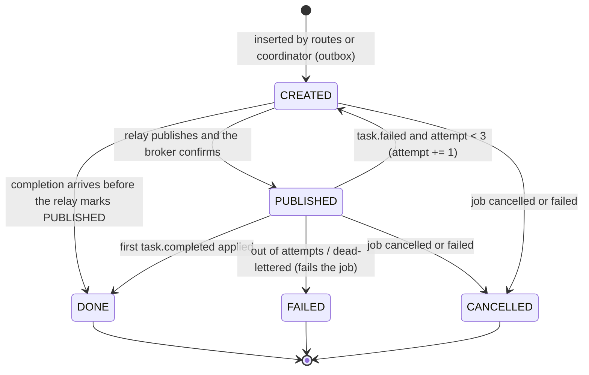
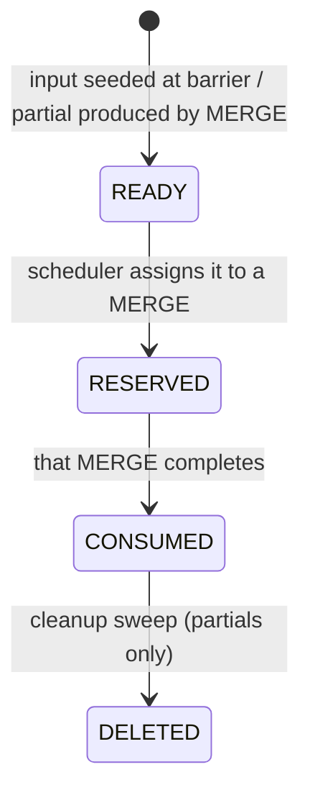

# State machines

## Job

"Ready to be evaluated" (IPD-001) is the GENERATING → REDUCING transition, recorded as `generation_completed_at`.

## Task

A task that runs out of attempts becomes `FAILED` and fails its whole job. The job's other open tasks become `CANCELLED`.

## Item (pool entry)

Invariant: for a `REDUCING` job, Σ count over `READY` and `RESERVED` items = F.
