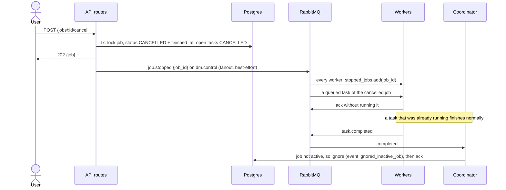

# Sequence: cancel a job

A worker that misses the broadcast runs the task anyway, and the coordinator ignores the result. That wastes work but stays correct. A job that fails follows the same path, with the coordinator publishing `job.stopped`.
