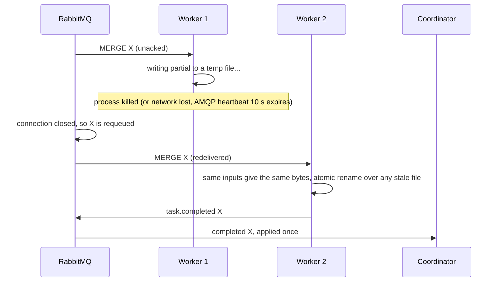
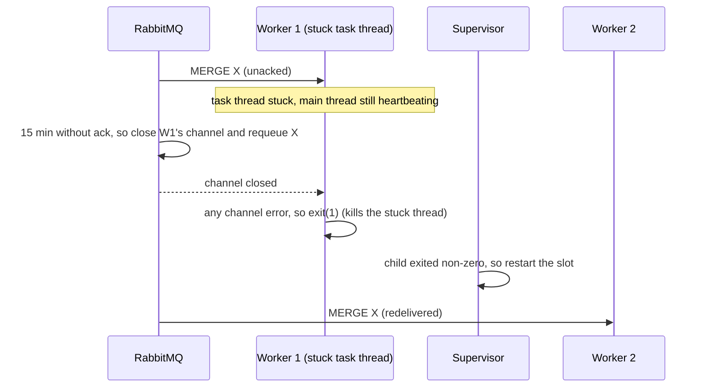
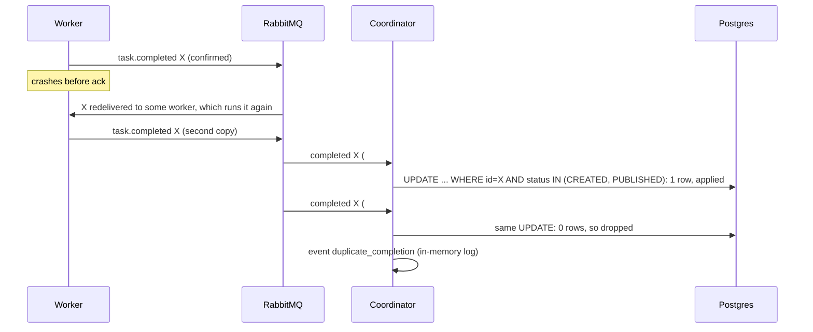
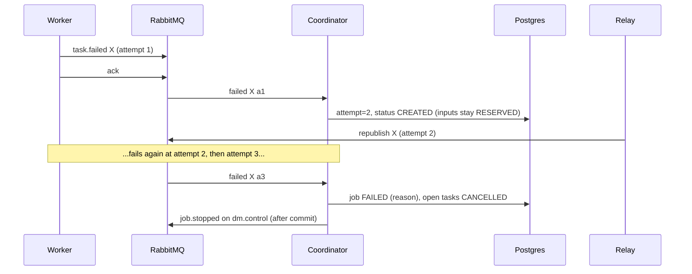
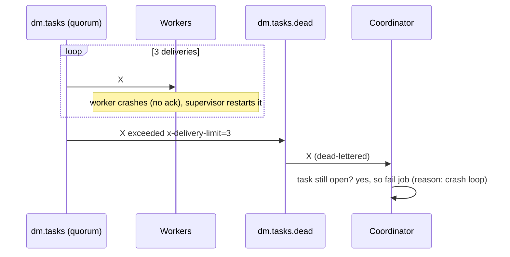
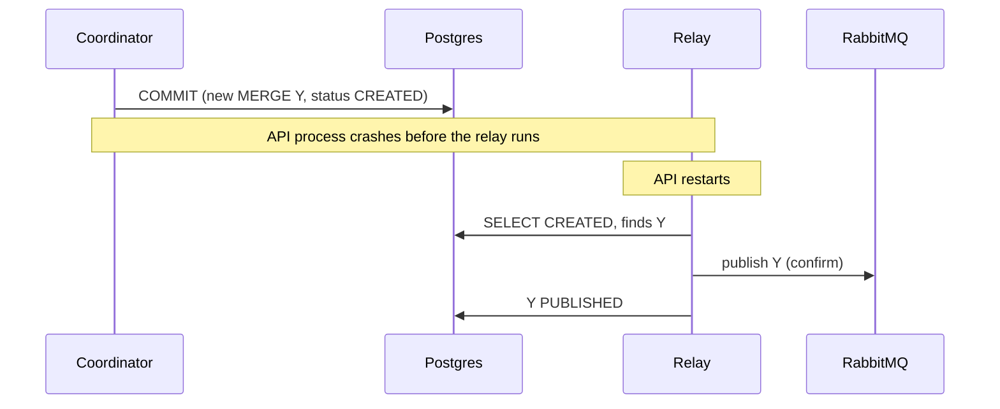
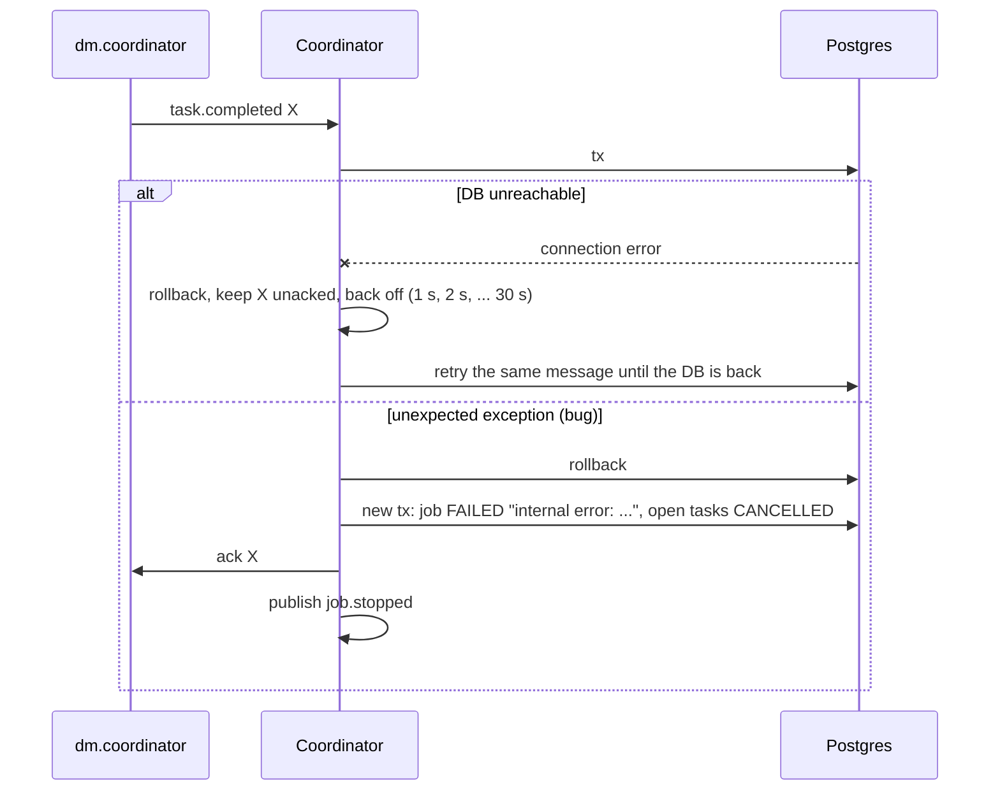

# Sequences: failure handling

## 1. Worker crashes mid-task: redelivery

A worker that hangs while its connection stays open is caught by `x-consumer-timeout` (15 min):

## 2. Duplicate completion is ignored

## 3. Task raises an error: retry, then fail the job

## 4. Poison message: delivery limit, dead letter, job failed

## 5. API crash between commit and publish: outbox recovery

If the crash happens after the coordinator commits but before it acks, the triggering completion is redelivered. The coordinator sees it as a duplicate and drops it, and the work it already committed stands.

## 6. Coordinator errors (ITD-002)

