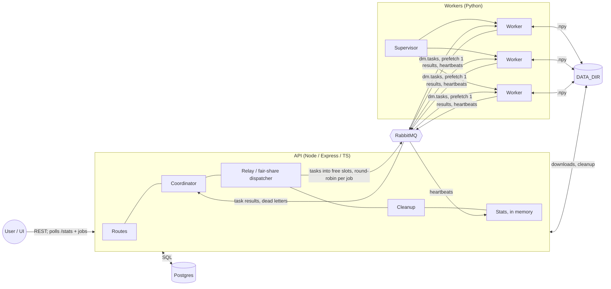

# High-level design

**Updated:** 2026-10-28 · [Design doc](design-doc.md) · [LLD](lld.md) · [Full component diagram](diagrams/components.md)

## 1. Overview

## 2. Components

| Component | Does | Must not |
|---|---|---|
| **Routes** | Create jobs (job + GENERATE tasks in one statement); list, get, cancel and delete jobs; task graph and CSV downloads (inputs, partials, result); `/fleet`, `/cleanup`, `/stats`, `/events` | Publish tasks directly |
| **Coordinator** | Single consumer of `dm.coordinator` and `dm.tasks.dead`. In one transaction per message: count generated files, run the barrier, schedule the pool, detect the final merge, retry or fail tasks | Ack before commit; trust paths from workers |
| **Outbox relay / dispatcher** | Fill free queue slots (about 2 per worker) with `CREATED` tasks, round-robin across jobs and deepest merge first; publish with confirms, then mark them `PUBLISHED` (ITD-003) | Flood the queue; reorder tasks inside the broker |
| **Cleanup** | Every 10 min and on demand: delete partials of finished jobs past retention (~1 h; ITD-010) | Touch active jobs |
| **Stats** | In-memory worker list (from heartbeats) and last-500 event buffer, plus SQL counts and RabbitMQ management stats | — |
| **`paths`** | Builds every file path | — |
| **Postgres** | `jobs`, `tasks` (also the outbox), `items` (the pool), `fleet` (desired W) | Be reached by workers |
| **RabbitMQ** | Delivery, redelivery, consumer timeout, delivery limit and dead-lettering, control broadcast. Topology from `definitions.json` | — |
| **Worker** | One task at a time: GENERATE or MERGE, atomic writes, publish the result, ack, heartbeat, skip stopped jobs, exit on broker error | Touch Postgres; exceed 5 files; build paths |
| **Supervisor** | Reconcile worker processes to `GET /fleet` target `W` (fallback `WORKER_COUNT`), restart crashed ones, drain on scale-down or SIGTERM | — |
| **UI** | Submit and manage jobs; poll `/stats` and the job list every 1 s; modal task DAG (`GET /jobs/:id/task-graph`, IPD-006) | — |

`job.stopped` is published by whichever piece stopped the job: the cancel route, or the coordinator when the job fails.

## 3. Topology (detail in [LLD §3](lld.md#3-rabbitmq-topology))

| Exchange | Queue(s) | Producer | Consumer |
|---|---|---|---|
| `dm.tasks` (direct) | `dm.tasks`: quorum, kept shallow by the dispatcher, delivery limit 3, dead-letters to `dm.dlx`, consumer timeout 15 min | Relay | Workers |
| `dm.dlx` (fanout) | `dm.tasks.dead` | RabbitMQ | Coordinator |
| `dm.events` (topic) | `dm.coordinator` (`task.*`), `dm.heartbeats` (`worker.heartbeat`, TTL 10 s) | Workers | Coordinator, Stats |
| `dm.control` (fanout) | One exclusive queue per worker | Routes, Coordinator | Workers |

## 4. Flow

1. **Submit:** `POST /jobs` creates the job (`GENERATING`) and ⌈F/5⌉ GENERATE tasks, then returns `201` with the job and a size estimate.
2. **Dispatch:** the relay publishes tasks only into free queue slots, one per active job per round, and marks them `PUBLISHED`. The rest wait as `CREATED` in Postgres (ITD-003).
3. **Generate:** workers write seeded `.npy` files, publish `task.completed`, then ack.
4. **Barrier:** the completion that makes `generated_files = F` seeds the pool and creates the leaf merges, in one transaction.
5. **Reduce:** each merge completion adds a partial to the pool; the scheduler merges any 5, or the last 2–4 once nothing else is open.
6. **Finish:** the final merge's worker writes the result; applying its completion marks the job `COMPLETED`.
7. **Observe:** the UI polls `/stats` and job endpoints; operators can open the task graph for lineage and CSV previews. `/events` stays available for scripts (ITD-012).

State machines: [job-state-machine.md](diagrams/job-state-machine.md). Sequence: [seq-job-lifecycle.md](diagrams/seq-job-lifecycle.md).

## 5. Data ownership

| Data | Written by | Read by |
|---|---|---|
| `jobs`, `tasks`, `items` | API only | API |
| Worker list, event buffer (memory) | API stats | API |
| Topology | `definitions.json` | RabbitMQ at boot |
| Inputs and partials | The worker running the producing task | Workers, API (CSV download) |
| Result | The worker running the final merge | API, user |
| Deletes | API (cleanup, `DELETE /jobs/:id`) | — |

## 6. Local deployment

| Process | Run with | Port |
|---|---|---|
| Postgres 16, RabbitMQ 4 + management | `docker compose up` (named volumes; RabbitMQ `hostname: rabbitmq`; loads `definitions.json`) | 5432; 5672, 15672 |
| API | `scripts/run-api.sh` (restart loop; the API exits on broker loss, ITD-005) | 3000 |
| Supervisor + W workers | `.venv/bin/python -m dismean_worker.supervisor` in `worker/` (W from `GET /fleet`) | — |
| UI | `npm run dev` in `ui/` (proxies `/api` to 3000) | 5173 |

The API and workers must use the same absolute `DATA_DIR`.

## 7. Production mapping (not built)

| Local | Production |
|---|---|
| API process | Containers behind a load balancer. Routes scale out; the coordinator runs as one leader, or sharded by job (future-work §2) |
| Postgres / RabbitMQ in Docker | Managed Postgres; Amazon MQ or CloudAMQP with 3-node quorum queues |
| `DATA_DIR` | S3 or GCS; lifecycle rules replace cleanup (future-work §5) |
| Supervisor | Kubernetes Deployment or ECS Service, one worker per container. Its memory limit makes the 5-file rule real |
| `GET/PUT /fleet` + supervisor | `replicas` / `desiredCount` set by the API, or KEDA scaling on the dispatch backlog with the API-set W as min/max bounds |
| `scripts/run-api.sh` | The orchestrator's restart policy |
| SIGTERM drain | Same, within the grace period. Unacked work is redelivered, so spot instances are safe |
| In-memory stats | Redis or Prometheus + Grafana, so any replica can answer |
| UI dev server | Static build on a CDN |

## 8. Limits

| Limit | Where it bites | Mitigation |
|---|---|---|
| Coordinator, one transaction per completion (about 200–1,000/s locally) | Very short tasks (small C) | Benchmark first (ITD-002), then batch, then shard |
| Disk: F·C of inputs + (M−1)·8C of partials per job | Large jobs, kept until cleanup | Retention window; object storage |
| Dispatch query: one window over all `CREATED` tasks per relay tick | Many very large jobs at once (about 20k rows per F = 100k job) | ITD-002 benchmark at F = 20k showed no relay pain (~91 completions/s); if many concurrent huge jobs, rank per job with a lateral `LIMIT` |
| Round-robin is per job, not per task cost | A job with huge C gets the same number of slots as one with tiny C | Weight rounds by C if it matters |

## 9. Security

Local only, with no authentication. HTTP and queue input is validated with zod in the API, and required keys are checked in the worker. File paths are built only from IDs by `paths`, never from user or worker input.
