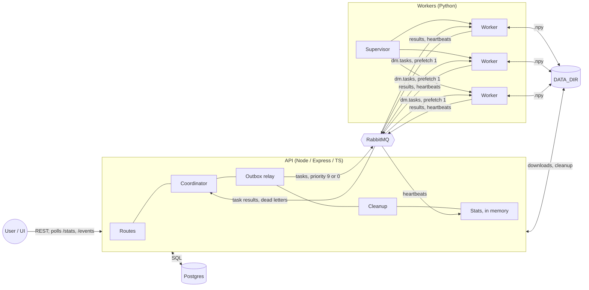

# High-level design

**Updated:** 2026-10-25 · [Design doc](design-doc.md) · [LLD](lld.md) · [Full component diagram](diagrams/components.md)

## 1. Overview

## 2. Components

| Component | Does | Must not |
|---|---|---|
| **Routes** | Create jobs (job + GENERATE tasks in one statement); list, get, cancel and delete jobs; downloads; `/fleet`, `/cleanup`, `/stats`, `/events` | Publish tasks directly |
| **Coordinator** | Single consumer of `dm.coordinator` and `dm.tasks.dead`. In one transaction per message: count generated files, run the barrier, schedule the pool, detect the final merge, retry or fail tasks | Ack before commit; trust paths from workers |
| **Outbox relay** | Publish `CREATED` tasks with confirms and priority, then mark them `PUBLISHED` | — |
| **Cleanup** | Every 10 min and on demand: delete partials of finished jobs past the retention window | Touch active jobs |
| **Stats** | In-memory worker list (from heartbeats) and last-500 event buffer, plus SQL counts and RabbitMQ management stats | — |
| **`paths`** | Builds every file path | — |
| **Postgres** | `jobs`, `tasks` (also the outbox), `items` (the pool), `fleet` (desired W) | Be reached by workers |
| **RabbitMQ** | Delivery, two-level priority, redelivery, consumer timeout, delivery limit and dead-lettering, control broadcast. Topology from `definitions.json` | — |
| **Worker** | One task at a time: GENERATE or MERGE, atomic writes, publish the result, ack, heartbeat, skip stopped jobs, exit on broker error | Touch Postgres; exceed 5 files; build paths |
| **Supervisor** | Reconcile worker processes to `GET /fleet` target `W` (fallback `WORKER_COUNT`), restart crashed ones, drain on scale-down or SIGTERM | — |
| **UI** | Submit and manage jobs; dashboard polling every 1 s | — |

`job.stopped` is published by whichever piece stopped the job: the cancel route, or the coordinator when the job fails.

## 3. Topology (detail in [LLD §3](lld.md#3-rabbitmq-topology))

| Exchange | Queue(s) | Producer | Consumer |
|---|---|---|---|
| `dm.tasks` (direct) | `dm.tasks`: quorum, 2 priority levels, delivery limit 3, dead-letters to `dm.dlx`, consumer timeout 15 min | Relay | Workers |
| `dm.dlx` (fanout) | `dm.tasks.dead` | RabbitMQ | Coordinator |
| `dm.events` (topic) | `dm.coordinator` (`task.*`), `dm.heartbeats` (`worker.heartbeat`, TTL 10 s) | Workers | Coordinator, Stats |
| `dm.control` (fanout) | One exclusive queue per worker | Routes, Coordinator | Workers |

## 4. Flow

1. **Submit:** `POST /jobs` creates the job (`GENERATING`) and ⌈F/5⌉ GENERATE tasks, then returns `201` with the job and a size estimate.
2. **Publish:** the relay publishes the tasks and marks them `PUBLISHED`.
3. **Generate:** workers write seeded `.npy` files, publish `task.completed`, then ack.
4. **Barrier:** the completion that makes `generated_files = F` seeds the pool and creates the leaf merges, in one transaction.
5. **Reduce:** each merge completion adds a partial to the pool; the scheduler merges any 5, or the last 2–4 once nothing else is open.
6. **Finish:** the final merge's worker writes the result; applying its completion marks the job `COMPLETED`.
7. **Observe:** the UI polls `/stats` and `/events`.

State machines: [job-state-machine.md](diagrams/job-state-machine.md). Sequence: [seq-job-lifecycle.md](diagrams/seq-job-lifecycle.md).

## 5. Data ownership

| Data | Written by | Read by |
|---|---|---|
| `jobs`, `tasks`, `items` | API only | API |
| Worker list, event buffer (memory) | API stats | API |
| Topology | `definitions.json` | RabbitMQ at boot |
| Inputs and partials | The worker running the producing task | Workers, API (CSV download) |
| Result | The worker running the final merge | API, user |
| Deletes | API (cleanup, `DELETE /jobs/:id`) | — |

## 6. Local deployment

| Process | Run with | Port |
|---|---|---|
| Postgres 16, RabbitMQ 4 + management | `docker compose up` (loads `definitions.json`) | 5432; 5672, 15672 |
| API | `npm run dev` in `api/` | 3000 |
| Supervisor + W workers | `uv run python -m dismean_worker.supervisor` in `worker/` | — |
| UI | `npm run dev` in `ui/` (proxies `/api` to 3000) | 5173 |

The API and workers must use the same absolute `DATA_DIR`.

## 7. Production mapping (not built)

| Local | Production |
|---|---|
| API process | Containers behind a load balancer. Routes scale out; the coordinator runs as one leader, or sharded by `job_id` (future-work §3) |
| Postgres / RabbitMQ in Docker | Managed Postgres; Amazon MQ or CloudAMQP with 3-node quorum queues |
| `DATA_DIR` | S3 or GCS; lifecycle rules replace cleanup (future-work §7) |
| Supervisor | Kubernetes Deployment or ECS Service, one worker per container. Its memory limit makes the 5-file rule real |
| `WORKER_COUNT` | `replicas` / `desiredCount`, or KEDA scaling on queue depth; an API-set W becomes min/max bounds (future-work §4) |
| SIGTERM drain | Same, within the grace period. Unacked work is redelivered, so spot instances are safe |
| In-memory stats | Redis or Prometheus + Grafana, so any replica can answer |
| UI dev server | Static build on a CDN |

## 8. Limits

| Limit | Where it bites | Mitigation |
|---|---|---|
| Coordinator, one transaction per completion (about 200–1,000/s locally) | Very short tasks (small C) | Benchmark first (ITD-027), then batch, then shard |
| Disk: F·C of inputs + (M−1)·8C of partials per job | Large jobs, kept until cleanup | Retention window; object storage |
| Queue depth: up to ⌈F/5⌉ per job | Never a problem for RabbitMQ | Dispatcher (future-work §1) |
| No strict fairness | A small job behind a big job's generation | Dispatcher |

## 9. Security

Local only, with no authentication. HTTP and queue input is validated with zod in the API, and required keys are checked in the worker. File paths are built only from IDs by `paths`, never from user or worker input.
